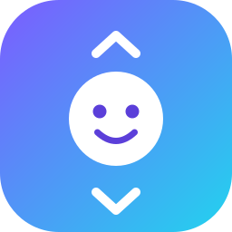

# HeadScroll

اپ اندروید برای کنترل ریلز (اینستاگرام، تیک‌تاک، یوتیوب Shorts…) با **حرکت سر** و **ژست دست**.

| ژست | پیش‌فرض |
|---|---|
| ⬆️ سر بالا | ریلز بعدی |
| ⬇️ سر پایین | ریلز قبلی |
| ➡️ سر به راست | سوایپ افقی بعدی |
| ⬅️ سر به چپ | سوایپ افقی قبلی |
| 👌 علامت OK | لایک (دابل‌تپ) |
| 🤏 پینچ | پخش / توقف |
| ✋ ✌️ 😄 | اختیاری |

## فناوری
- CameraX (دوربین جلو) + ML Kit Face Detection (زاویه سر، لبخند)
- MediaPipe Hand Landmarker (ژست دست)
- AccessibilityService (سوایپ و تپ) + Foreground Service + Quick Tile

## ساخت APK
پروژه رو روی GitHub پوش کن، تب **Actions ← Build APK**. مدل دست (`hand_landmarker.task`) خودکار تو CI دانلود و داخل APK گذاشته میشه.
برای بیلد لوکال، مدل رو دستی بذار تو `app/src/main/assets/`:
`https://storage.googleapis.com/mediapipe-models/hand_landmarker/hand_landmarker/float16/latest/hand_landmarker.task`

## نصب
1. APK رو نصب کن (از [Releases](../../releases/tag/latest))
2. اپ ← کارت «راه‌اندازی»: Accessibility، دوربین و اعلان رو فعال کن
3. «روشن کردن» رو بزن، بعد «✨ کالیبراسیون هوشمند»
4. اینستا رو باز کن و سرتو تکون بده

## کالیبراسیون
- **خودکار**: هر بار چهره برگرده یا اپ عوض شه حالت عادی سرت دوباره یاد گرفته میشه
- **هوشمند**: ۱۵ ثانیه، بالا/پایین/چپ/راست رو نشون میدی و آستانه‌ها خودکار تنظیم میشن

فونت: [Vazirmatn](https://github.com/rastikerdar/vazirmatn) (OFL). تغییرات: [CHANGELOG.md](CHANGELOG.md)
